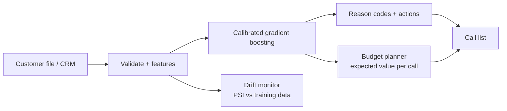

# ChurnShield


**Which bank customers are about to leave, why, and who to call first with this month's retention budget.**

A churn score alone does not tell a retention team what to do. ChurnShield turns it into a ranked call list: each customer's churn probability, the reasons behind it, a suggested talking point, and the expected value of calling them, picked to fit a fixed budget.

## Results on 10,000 real bank customers

Trained on 8,000 customers, measured once on 2,000 held out. Full numbers in [`models/report.md`](models/report.md), regenerated by CI on every push.

| Metric | Value |
|---|---|
| ROC-AUC (held out) | **0.864** |
| Top 10% riskiest: share who actually left | **82%**, 4.0x the 20% base rate |
| Calibration (Brier score) | 0.101: a score of 0.3 means about a 30% chance of leaving |

### The business test: EUR 20,000 retention budget

Each strategy contacts 500 held-out customers. Value is realised with what actually happened: only customers who really left can be saved.

| Who to call | Real leavers reached | Net value (EUR) |
|---|---|---|
| **ChurnShield: expected value** | 239 | **406,848** |
| Highest churn probability | 287 | 360,877 |
| Highest balance | 112 | 223,596 |
| Random | 95 | 111,726 |

The value plan reaches *fewer* leavers than ranking by probability, yet earns **13% more**: it skips likely leavers who are worth less than the call costs. Against random targeting it is **3.6x**.

> Assumptions (all configurable): EUR 40 per contact, 30% of would-be leavers kept by the offer, value = 1.5% margin on balance + EUR 60 per product per year over 3 years. Without past campaign data (treated vs untreated customers) true uplift cannot be learned; the success rate is a business input, and the first real campaign should be run with a control group to measure it.

## What a relationship manager sees

| Customer | Churn | Why | Talking points |
|---|---|---|---|
| 15764604 | 99% | Product holding · Balance pattern · Inactive | Review product fit · Savings / term deposit offer · Re-engage via app onboarding |

Reasons come from a model-agnostic test: reset one driver (activity, products, age, balance, market, credit score, tenure) to the typical value among customers who stayed, and measure how much the risk drops.

## Responsible by design

| Concern | What ChurnShield does |
|---|---|
| Gender bias in offers | Gender is **not a model input**. Measured cost of excluding it: 0.002 ROC-AUC. Model quality is equal across genders (AUC 0.860 vs 0.865) |
| Market differences | Germany has 31% churn vs 17% elsewhere; the model flags more German customers because more leave, with similar AUC (0.85 to 0.86) in every market |
| Overconfident scores | Isotonic calibration; probabilities clipped to 1 to 99% |
| Silent model decay | PSI drift check per feature (stable < 0.10, act > 0.25); a simulated bad month scores PSI 2.18 and triggers "retrain" |
| Bad input rows | Validated against plausible ranges and rejected with a reason, never silently scored |

## Who buys it and how it is sold

| | |
|---|---|
| **Buyers** | Retail banks, small finance and cooperative banks, NBFCs and fintech lenders; the same approach fits insurers and telecoms with a data mapping |
| **Their pain** | A fixed retention budget is spent on whoever looks riskiest or richest, so offers go to customers who would have stayed anyway, or who are worth less than the call |
| **What they get** | A monthly call list sized to the budget: who to call, why they may leave, what to say, and the expected value of each call, plus a drift alert when the model needs retraining |
| **Deployment** | Docker inside the bank's network; customer data never leaves it. Monthly batch through the API or a CSV export from the core banking system or CRM |
| **Governance** | Every score has its reasons, the model card and held-out metrics are regenerated on each run, and CI blocks a model below AUC 0.84: the evidence model-risk and audit teams ask for |

**ROI from the benchmark above:** with the same EUR 20,000 budget and 500 calls, the value plan earns **EUR 45,971 more** than calling the highest-probability customers and **3.6x** random targeting. For a bank, that difference repeats every campaign.

| Plan (suggested) | For | Price idea |
|---|---|---|
| Setup | Every client | One-time fee: map their data fields, retrain on their history, set the budget rules |
| Subscription | Small banks, NBFCs | Monthly fee per 10,000 active customers scored |
| Enterprise | Larger banks | Annual licence, on-premise, quarterly retraining and a model review report |

**Pilot plan (90 days):** retrain on the bank's last 12 months of customers, then run one campaign split into three groups: ChurnShield's list, the bank's usual list, and an untouched control group. Comparing them measures the real uplift and the real save rate, which also replaces the 30% assumption above with the bank's own number.

## How it works



| Choice | Why |
|---|---|
| 3 candidates, 5-fold CV on train only | Logistic regression 0.780, random forest 0.857, gradient boosting 0.857 |
| Near-tie goes to the simpler model | Gradient boosting chosen over random forest: same AUC, lower variance, 3 MB artifact instead of 125 MB |
| Calibrated probabilities | The planner multiplies probability by money, so scores must mean what they say |
| Held-out set used once | Final report only; no tuning against it |

## Use it

```bash
pip install -e ".[app]" && streamlit run app.py          # demo with 2,000 sample customers
```

```bash
pip install -e .
churnshield score customers.csv --out scored.csv
churnshield plan customers.csv --budget 20000 --out call_list.csv
churnshield drift this_month.csv
python -m churnshield.train --gate                       # retrain; fails below AUC 0.84 or lift 2.5x
```

```bash
pip install -e ".[api]" && uvicorn churnshield.api:app    # or: docker build -t churnshield . && docker run -p 8000:8000 churnshield
```

| Endpoint | Purpose |
|---|---|
| `GET /health` | Model name, training date, held-out AUC |
| `POST /v1/score` | Customers in; probability, risk band, reasons, rejected rows out |
| `POST /v1/plan` | Customers + budget in; ranked call list with expected value |
| `POST /v1/drift` | This month's customers in; PSI per feature and a retrain flag |

## Data

`data/European_Bank.xlsx`: 10,000 retail bank customers in France, Germany and Spain, 20.4% churn. Model inputs: credit score, market, age, tenure, balance, products, card, activity, salary, plus four engineered features (zero balance, balance-to-salary, products per tenure year, inactive multi-product). Surname and gender are never used.

## Limitations

- One snapshot year: no out-of-time validation yet. The drift monitor is the guard until monthly data arrives.
- Offer success rate is an assumption, not measured uplift (see above).
- Reason codes are one-driver-at-a-time effects, not a full causal explanation.

## Project layout

```
src/churnshield/data.py      schema, validation, features (protected attributes excluded)
src/churnshield/model.py     candidates, CV, simplest-on-tie selection, calibration, metrics
src/churnshield/explain.py   reason codes and suggested actions
src/churnshield/plan.py      budget planner and strategy comparison
src/churnshield/monitor.py   PSI drift and segment fairness report
src/churnshield/train.py     end-to-end training, model report, quality gate
src/churnshield/api.py       FastAPI service
app.py                      Streamlit demo
```
